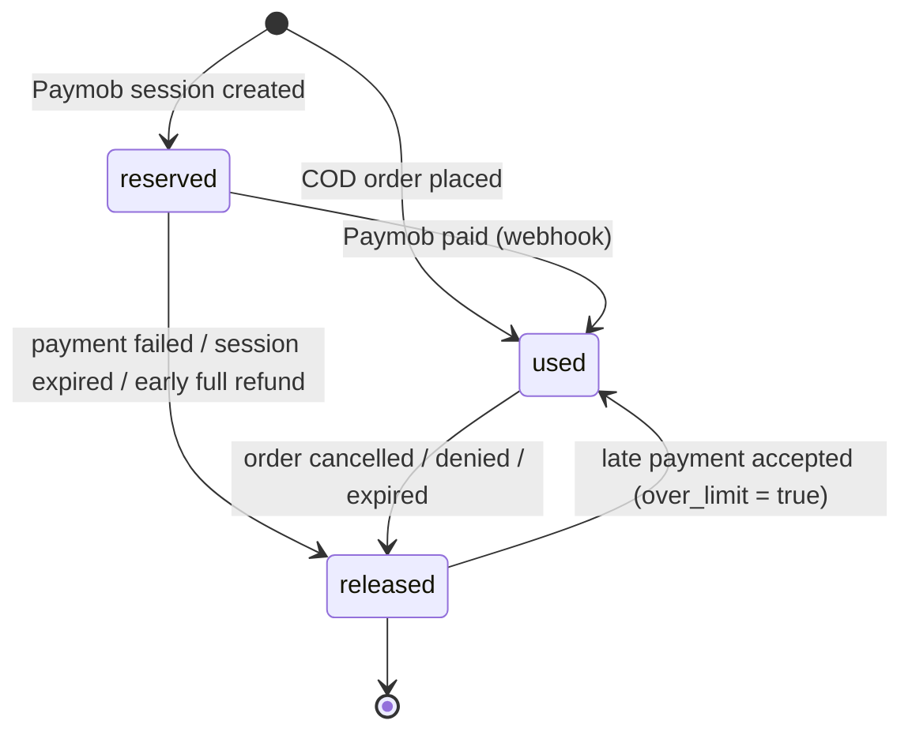

# Promo Codes — Spec, Decisions & Edge Cases

Status: agreed design, not yet implemented · Written 2026-11-18

This document records every decision made for promo codes, how they fit the existing discount, checkout, Paymob and Bosta code, and every edge case found while reading that code. It is the source of truth for implementation and tests.

---

## 1. Summary

A **promo code** is a code a logged-in customer types in the cart or at checkout. One code can give any combination of:

- a **percentage** or **fixed amount** discount on eligible items,
- **free shipping**,
- a **free gift** item.

Codes are created and managed by staff in the ERP, can be limited by time, usage, customer, order amount and eligible items, and can never be edited or deleted once created.

### In scope

- Percentage, fixed amount, free shipping, free gift (combinable in one code)
- First-order codes, private codes for hand-picked customers
- Usage limits (total and per customer), order amount range, eligible piece rules
- Pause / resume / stop, optional schedule
- ERP management, permissions, reporting

### Out of scope (for now)

| Item | Note |
|---|---|
| Automatic promotions (no code typed) | Can be added later on the same rules engine |
| More than one code per order | One code only |
| Guest checkout with codes | Logged-in customers only |
| Staff applying a code to an order | ERP cannot create or edit order items today |
| Exchanges | Not offered by the store (Bosta supports them; we don't use it) |
| "My codes" page in the customer account | Data supports it (`show_in_account` flag, off); no UI now |
| Referral codes, loyalty points, gift cards | Separate systems; must not conflict with this data model |

---

## 2. Current system (what exists today)

### 2.1 Existing discounts

- `variant_discounts` — one discount per product variant (`variant_id` unique): `percentage | fixed`, value, `starts_at`, `ends_at`, `status`.
- `bundle_discounts` — one discount per offer or per collection (exactly one of the two set).
- ERP bulk apply (`apps/api/src/modules/admin/discounts/admin-discounts.controller.ts`) upserts, so it **silently overwrites** an existing discount.
- No order-level discount, no code table.

### 2.2 How a checkout is priced

`priceCheckout` (`apps/api/src/modules/orders/orders.service.ts`):

1. For each cart line, load the base price (variant `selling_price`, or offer/collection `fixed_price`) and its discount.
2. `resolveEffectiveDiscountedPrice` returns the discounted `unitPrice`; `lineTotal = unitPrice × qty`.
3. Snapshot on the line: `snapshot_base_unit_price`, `snapshot_discount_id/type/value/starts_at/ends_at`.
4. For offers/collections, `snapshot_components` stores component variants with their **undiscounted** selling price.
5. `totalAmount = Σ lineTotal`; order total = `totalAmount + shipping`.

### 2.3 Invariants the rest of the system relies on

These checks all assume **Σ lineTotal = products total** and **order total = products + shipping**. Any promo design must keep them true.

| Where | Check | If broken |
|---|---|---|
| `payments/paymob/paymob-transaction.service.ts` (~L267) | Σ snapshot `lineTotal` + shipping = paid amount; shipping quote totals match | Paid order not created → `reconciliation_required` |
| `shipping/bosta/bosta-delivery.service.ts` (~L112) | Σ `lineTotal` = `quote.productsTotalCents`; order total = `quote.amountCents` | Every shipment fails: "Locked delivery amount/size/items snapshot mismatch" |
| `shipping/shipping-sync.repository.ts` (~L65) | Bosta collected COD = order total | COD payment never verified |
| `shipping/shipping-cancellation.repository.ts` (L19) | Refund due = order total − refunded | Wrong refund amount |
| `checkout/paymob-checkout.service.ts`, `orders.service.ts` | `expectedAmountCents` from the storefront = server total | `CheckoutAmountChangedError` |
| `shipping/checkout-shipping.service.ts` | Quote fingerprint includes priced items and products total | `SHIPPING_QUOTE_CHANGED` |

### 2.4 Other relevant behaviour

- **Storefront computes its own total** (`apps/storefront/src/hooks/use-checkout.ts:144`) and sends `expectedAmountCents`.
- **Free orders:** total 0 → `paymentStatus: "accepted"`, `codExpiresAt: null`, Paymob skipped (`checkout.service.ts:50`).
- **Paymob orders are created in the webhook** from `checkout_sessions.cart_snapshot`, not re-priced.
- **Paymob intention is sent with `items: []`** and an expiration equal to the reservation's remaining seconds.
- **Stock is restored in four different places:** `restockOrderItems`, `expirePendingCodOrder` (both `orders/order/write.ts`), `finishShippingCancellation` (`shipping-cancellation.repository.ts`), and the Paymob deny path (restores from `checkout_reservations`, not from order lines).
- **Destination changes** (city/zone/district) are refused by shipment edit; staff cancel and the customer re-orders.
- **COD limit:** EGP 30,000 including delivery (`shipping-restrictions.ts`).
- **Phone formats differ:** COD orders store the phone as typed (`010…`); Paymob sessions/orders store `+2010…` (see §10.3).

---

## 3. Decisions

### 3.1 Who and how many

| Topic | Decision |
|---|---|
| Who can use codes | Logged-in customers only |
| Guest types a code | "Log in to use promo codes" + login button; the code is kept and applied after login |
| Codes per order | One |
| Where | Cart and checkout. Re-validated at checkout; removed with a message if no longer valid |

### 3.2 Benefits (one code may combine several)

| Benefit | Decision |
|---|---|
| Percentage | % off eligible pieces; **optional cap** (max saving in EGP) per code |
| Fixed amount | Off the **eligible total once**, spread across eligible pieces; never below 0 |
| Free shipping | Customer's delivery fee = 0; store pays Bosta; real fee recorded |
| Free gift | Any sellable item: product variant, offer, or collection, with quantity. Added automatically at 0 EGP when rules pass; removed when they stop passing |
| Gift out of stock | Code still works without the gift; customer is told |
| Gift and rules | The gift **never** counts toward any rule (amount range, piece counts) |

### 3.3 Eligible items

- Admin can choose: **whole store**, **categories** (including sub-categories), specific **products**, **offers**, **collections**, plus **exclusions**.
- Only lines that are eligible directly count. A product inside an offer/collection is **not** eligible through that offer/collection.

### 3.4 Interaction with existing sale discounts

- On every piece the code applies to, the code **replaces** the sale discount. The code is calculated from the **original price**.
- Before applying, the customer sees a confirmation listing affected items and their new price, e.g. *"Applying this code removes the sale on Shirt A; it will cost 800 EGP instead of 700. Continue?"*
- This applies **even when the code makes the piece more expensive**; the customer decides.
- Items the code doesn't apply to keep their sale price.

### 3.5 Rules

| Rule | Decision |
|---|---|
| Order amount range | Optional min and max. Compared against **cart items as shown** (with sale prices), **before the code**, **without shipping**, excluding the gift. Outside the range → code rejected |
| Min eligible pieces | Condition: fewer eligible pieces → code rejected |
| Max discounted pieces | How many pieces get the discount. Each piece counts separately (qty 3 = 3 pieces). Pieces with the **biggest saving against the original price** (original price − code price) are chosen; ties go to the more expensive piece. Example: max 5, cart has 6 eligible pieces → best 5 discounted |
| Total usage limit | Optional max (empty = unlimited) |
| Per-customer limit | Optional max (empty = unlimited). No minimums |
| First-order code | Blocked if the **account** or the **checkout phone** has **any** previous order, including cancelled, denied or expired ones |
| Private code | Admin hand-picks customer accounts; only they can use it. Staff share the code themselves |
| Schedule | Start and end both optional. No start → active from creation time. No end → runs until paused/stopped |
| Online payment minimum | Total after code must be ≥ **10 EGP** for Paymob; below that, only COD or the free-order path is offered |
| Total reaches 0 | Allowed; order is created and **flagged for staff review** before shipping |

### 3.6 Usage counting

| Event | Effect |
|---|---|
| COD order placed | Use counted |
| Paymob session created | Use **reserved** |
| Paymob paid (webhook) | Reserved → used |
| Paymob failed / session expired | Reservation released |
| Order cancelled / denied / expired | Use given back |
| Paymob payment arrives after reservation expired | **Honor the code** even if over limit or paused; marked "over limit (late payment)" |
| Partial return | Use is **not** given back |

### 3.7 Returns and refunds

- Refund = what the customer **actually paid** for the returned items (after the code). The rest of the order keeps its discount even if it drops below the minimum.
- Free gift: customer **keeps it**, even when returning the items that qualified for it; refund is the full paid price of the returned items.

### 3.8 Lifecycle

- Once created, a code **cannot be edited**. To change anything, create a new code.
- Codes **cannot be deleted**.
- States: `active` ⇄ `paused` → `stopped` (final). Pause/resume any time; stop is permanent.
- Code text: admin types it (e.g. `SUMMER20`) or presses "generate". Not case-sensitive; unique forever; generated codes exclude look-alike characters (0/O, 1/I/L).

### 3.9 First-order and destination changes

When a destination change forces cancel + re-order, the cancelled order **still counts** as a previous order. Staff create a private code for that customer if needed.

---

## 4. Pricing algorithm

Runs inside `priceCheckout`, after existing line pricing, so every caller (COD submit, Paymob session, quote request, cart preview) gets identical numbers.

### 4.1 Order of operations

1. **Price lines as today** (sale discounts applied).
2. **Validate the code** (§4.2). Any failure → specific error (§9.3); the cart prices from step 1 are returned unchanged.
3. **Find eligible pieces:** expand eligible lines into pieces (qty 3 → 3 pieces). Exclude the gift.
4. **Check min eligible pieces.**
5. **Compute each piece's code price** from its **original price**:
   - percentage: `original × (1 − pct)`
   - fixed: computed at step 7 (spread)
6. **Choose discounted pieces:** if `max_discounted_pieces` is set, take the N pieces with the biggest saving against the original price (§11.1). Both percentage and fixed savings scale with the original price, so this means the most expensive pieces first; ties keep cart order.
7. **Apply amount:**
   - **Percentage:** sum per-piece discounts; if a cap is set and the sum exceeds it, scale every piece's discount down proportionally to the cap.
   - **Fixed:** spread the fixed amount over the chosen pieces in proportion to their original price; never more than the pieces' total.
8. **Replace sale discounts** on chosen pieces (their sale saving is dropped; code applies to original price).
9. **Allocate to lines and round** (§4.3).
10. **Add the gift line** (§4.4).
11. **Shipping:** quote is calculated with promo-adjusted items (including gift) and payment method (§5.2). Free shipping sets the customer's fee to 0.
12. **Final checks:** COD limit, online minimum (10 EGP), total 0 → review flag.

### 4.2 Validation checklist (in this order, first failure wins)

1. Customer is logged in
2. Code exists (case-insensitive lookup)
3. Status is `active`
4. Now is within `[starts_at, ends_at]` (when set)
5. Private code → customer is on the list
6. First-order code → no previous order by account id **or** normalized checkout phone **or** account phone
7. Total usage limit not reached (reserved + used)
8. Per-customer limit not reached (by account id **or** normalized phone)
9. Order amount within range
10. Min eligible pieces met
11. Code has some effect (at least one discounted piece, free shipping available, or gift available)

### 4.3 Allocation and rounding

- A line's promo discount = sum of its discounted pieces' discounts.
- New `lineTotal` = (pieces at code price) + (pieces not chosen, at their normal price).
- Round to piastres with **largest remainder**; leftover piastres go to the most expensive line.
- Consequence: `lineTotal` may differ from `unitPrice × qty`. UI and reports must display `lineTotal`, never recompute it.
- When only some pieces of a line are discounted, keep **one line**, with `unitPrice` = original price, `lineTotal` = actual paid total, and `promo_discount_amount` holding the difference. (Splitting a line into two would break restock and review logic, which key on lines.)

### 4.4 Gift line

- Separate order line: `unit_price = 0`, `line_total = 0`, `is_promo_gift = true`.
- Uses the normal item types (`product_variant`, `offer`, `collection`); offers/collections carry `snapshot_components`.
- Must **not** pass through `resolveEffectiveDiscountedPrice` (it throws on a 0 fixed price).
- Included in stock decrement, `checkout_reservations`, shipping quote size, and all restock paths.

### 4.5 Why the discount goes into line totals ("option A")

Putting the discount into `lineTotal` keeps every invariant in §2.3 true with no change to Paymob, Bosta, COD collection or refund checks, and gives per-item paid prices for partial refunds. The alternative (an order-level discount field) would require changing all of those checks.

---

## 5. Payment and shipping integration

### 5.1 Storefront total

The storefront can no longer compute the total itself. A server endpoint returns the priced cart with the code applied (lines, savings breakdown, gift, warnings such as "sale removed on X"). The storefront displays and submits **that** total as `expectedAmountCents`.

### 5.2 Shipping quote

- The quote request must include the promo code; the quote fingerprint already hashes priced items and products total, so the code changes it automatically.
- Changing or removing the code → new quote.
- The gift is in the items before quoting, so the parcel `size` includes it.
- **Free shipping:** the quote stores two numbers:
  - `carrier_shipping_cents` — what Bosta charges the store
  - `shipping_amount_cents` — what the customer pays (0)

  All existing total checks (Paymob, Bosta `amountCents`, COD collection) use the **customer** amount. Bosta's COD = what the customer owes.
- **Shipping disabled** (`availability.enabled = false`): a code whose only benefit is free shipping is rejected ("free delivery isn't available"); other benefits still apply.

### 5.3 COD

- The COD limit (EGP 30,000 incl. delivery) is checked **after** the code. A code can bring a cart under the limit; removing the code can push it back over.

### 5.4 Paymob

- Promo snapshot (code id, code text, per-line promo amounts, free-shipping flag, gift line) is saved in `checkout_sessions` at session creation.
- The webhook **never re-validates** the code; it converts the reservation to `used` in the same transaction that creates the order.
- Retries (up to 3 attempts) reuse the session amount, so a code paused/expired mid-payment is honored for that session.
- Early refund before the order exists (`earlyRefundAmountCents` = full amount) → release the use.
- Total below 10 EGP → Paymob not offered.

### 5.5 Free orders (total 0)

- Path as today (no Paymob, `accepted`, `codExpiresAt: null`) **plus** a review flag (e.g. `promo_free_review`). Shipping is blocked until staff accept or deny it.
- Because `codExpiresAt` is null, the 96-hour expiry never cancels it, so the flag must show on the dashboard.

---

## 6. Usage lifecycle

### 6.1 Where uses are released (all four stock-restore paths + Paymob)

| Path | File | When |
|---|---|---|
| Staff deny, COD without shipping | `orders/order/write.ts` → `restockOrderItems` | Immediately |
| COD untouched 96 h | `orders/order/write.ts` → `expirePendingCodOrder` | On expiry |
| Cancellation in shipping | `shipping/shipping-cancellation.repository.ts` → `finishShippingCancellation` | Only when **completed**, not when requested |
| Staff deny, Paymob | `orders/order/write.ts` (reservation restock branch) | Immediately |
| Paymob session expires / fails | `checkout/checkout-reservation.repository.ts` → `releaseExpiredCheckoutReservations` | With stock release |

Each path needs its own test (§10.4). Missing one loses the use forever.

### 6.2 Concurrency

- Validation in the cart is advisory. The binding check runs **inside the transaction** that creates the COD order or the Paymob session:
  - lock the `promo_codes` row `FOR UPDATE`,
  - count `reserved + used` redemptions (total and per customer),
  - insert the redemption.
- Two tabs with the same single-use code: the second fails with "This code is in use on another checkout", not "invalid".

---

## 7. Edge cases catalog

| # | Area | Case | Resolution |
|---|---|---|---|
| 1 | Paymob | Payment arrives after reservation expired; code over limit/paused | Honor; `over_limit = true`; shown in report |
| 2 | Paymob | Code paused/expired while customer is on Paymob page | Honored for that session (amount is fixed) |
| 3 | Paymob | Early refund before order exists | Release the use |
| 4 | Paymob | Webhook creates order from snapshot | Promo data must be in the session snapshot; no re-validation |
| 5 | Paymob | Same customer, two tabs, single-use code | Row lock; second gets "in use on another checkout" |
| 6 | Paymob | Deny restores stock from reservations, not lines | Gift must be in `checkout_reservations` |
| 7 | Paymob | Total after code < 10 EGP | Paymob hidden; COD or free-order path |
| 8 | Paymob | Partial refund unsupported for some methods (undocumented) | Staff handle manually; ERP shows per-line paid prices |
| 9 | Bosta | Gift changes parcel size | Gift added before quoting |
| 10 | Bosta | Free shipping vs `quote.amountCents === order total` | Store carrier fee separately; checks use customer amount |
| 11 | Bosta | Shipping disabled, free-shipping-only code | Reject with clear message |
| 12 | Bosta | Code moves cart under/over the EGP 30,000 COD limit | COD check after code |
| 13 | Bosta | Destination change → cancel + re-order; first-order code blocked | By design; staff create a private code |
| 14 | Bosta | COD collected must equal order total | Holds because discount is in line totals |
| 15 | Cancel | Cancellation pending for days | Release use only on completion |
| 16 | Cancel | Free order never expires | Review flag on dashboard |
| 17 | Refund | Partial refund blocks customer cancellation (existing rule) | Expect more staff reviews; no change |
| 18 | Refund | Returned items drop order below minimum | Refund paid price; keep discount on the rest |
| 19 | Gift | Customer keeps gift, returns qualifying items | Full refund of paid price; gift kept |
| 20 | Gift | Gift out of stock | Code works without it; message |
| 21 | Gift | Gift line price 0 vs `resolveEffectiveDiscountedPrice` | Separate path; never through that function |
| 22 | Identity | Phone stored in two formats | Normalize everywhere + migrate (§10.3). **Prerequisite** |
| 23 | Identity | Delete account, re-register with same phone | Per-customer limits count account **or** phone |
| 24 | Identity | Customer changes account phone | First-order check uses account id + both phones |
| 25 | Identity | Private code forwarded on WhatsApp | Checked by account, not by knowing the code |
| 26 | Pricing | Sale starts/ends between cart and checkout | Server re-prices → total changes → customer confirms again; dialog mentions newly affected items |
| 27 | Pricing | Code makes a sale item more expensive | Allowed; confirmation shows new price |
| 28 | Pricing | Fixed amount doesn't divide evenly | Largest-remainder rounding; leftovers on most expensive line |
| 29 | Pricing | Cart changes after code applied | Cart: code shown "no longer valid" + reason; checkout: removed with message |
| 30 | Pricing | Percentage with cap | Scale all piece discounts proportionally |
| 31 | Pricing | Fixed amount > eligible total | Discount = eligible total (items can reach 0) |
| 32 | Pricing | Product inside an offer/collection | Not eligible through the bundle |
| 33 | Time | Schedules with no timezone (`datetime`) | Verify server + DB + ERP inputs use Cairo time before launch |
| 34 | Idempotency | Retry with same key but different code | Code is in the payload → different fingerprint → treated as different checkout |
| 35 | ERP | Bulk sale apply overwrites silently (existing) | Promo codes are immutable instead; past orders reference the exact version |
| 36 | ERP | "Savings" on order page mixes sale and promo | Split into sale / promo / free shipping / gift value |
| 37 | Reports | Free shipping cost invisible today | Report shows carrier fee absorbed |
| 38 | Exchanges | Code tracks Bosta exchange/return shipments if created on Bosta's dashboard | Out of scope; promo logic ignores them |

---

## 8. Data model proposal

Names follow existing conventions (snake_case, `decimal(10,2)` for money on items, cents `int` on orders/sessions).

### 8.1 `promo_codes`

| Column | Type | Notes |
|---|---|---|
| `id` | int PK | |
| `code` | varchar(64) | As entered (display) |
| `code_normalized` | varchar(64) **unique** | Uppercased, trimmed |
| `ar_name`, `en_name` | varchar(255) | Internal/customer-facing label |
| `status` | enum `active`, `paused`, `stopped` | |
| `starts_at` | datetime | Defaults to creation time |
| `ends_at` | datetime null | |
| `discount_type` | enum `percentage`, `fixed` null | Null = no discount benefit |
| `discount_value` | decimal(10,2) null | |
| `max_discount_amount` | decimal(10,2) null | Percentage cap |
| `free_shipping` | boolean | |
| `gift_item_type` | enum `product_variant`, `offer`, `collection` null | |
| `gift_item_id` | int null | |
| `gift_qty` | int null | |
| `eligibility_scope` | enum `all`, `selected` | |
| `min_order_amount`, `max_order_amount` | decimal(10,2) null | |
| `min_eligible_pieces` | int null | |
| `max_discounted_pieces` | int null | |
| `total_usage_limit` | int null | |
| `per_customer_limit` | int null | |
| `first_order_only` | boolean | |
| `is_private` | boolean | |
| `show_in_account` | boolean default false | Future "My codes" |
| `created_by_admin_id` | int FK | |
| `created_at`, `updated_at` | timestamp | `updated_at` changes only on status |

Rule rows are immutable after insert; only `status` changes (enforced in the API and covered by tests).

### 8.2 `promo_code_targets` (eligibility)

`promo_code_id`, `target_type` (`category`, `product`, `variant`, `offer`, `collection`), `target_id`, `mode` (`include`, `exclude`). Unique on all but `id`.

### 8.3 `promo_code_customers` (private codes)

`promo_code_id`, `customer_id`. Unique pair.

### 8.4 `promo_redemptions`

| Column | Notes |
|---|---|
| `id` | |
| `promo_code_id` | FK |
| `customer_id` | FK, set null on delete |
| `phone_normalized` | For limits after account deletion |
| `checkout_session_id` | null for COD |
| `order_id` | null until order exists |
| `state` | `reserved`, `used`, `released` |
| `release_reason` | `payment_failed`, `session_expired`, `early_refund`, `cancelled`, `denied`, `expired` |
| `over_limit` | boolean (late payment) |
| `discount_cents`, `shipping_waived_cents`, `gift_value_cents` | For reports |
| timestamps | |

Index on `(promo_code_id, state)`, `(promo_code_id, customer_id)`, `(promo_code_id, phone_normalized)`.

### 8.5 `promo_code_events` (audit)

`promo_code_id`, `action` (`created`, `paused`, `resumed`, `stopped`), `admin_user_id`, `created_at`.

### 8.6 Changes to existing tables

**`order_items`**

- `promo_discount_amount` decimal(10,2) null
- `promo_replaced_discount_id` int null (sale discount removed by the code)
- `is_promo_gift` boolean default false

**`orders`** and **`checkout_sessions`**

- `promo_code_id` int null, `promo_code_text` varchar(64) null
- `promo_snapshot` text null (rules as applied)
- `promo_discount_cents` int default 0
- `promo_shipping_waived_cents` int default 0 (= carrier fee absorbed)

**Shipping quote snapshot**: add `carrierShippingAmountCents` next to `shippingAmountCents`.

---

## 9. ERP, reporting, permissions, customer UX

### 9.1 Permissions

New keys alongside `discounts.manage`, granted per staff member by the admin:

| Key | Allows |
|---|---|
| `promos.read` | View codes and reports |
| `promos.create` | Create codes (including duplicating an existing one as a starting point) |
| `promos.update_status` | Pause, resume, stop |

### 9.2 ERP screens

- **List:** code, benefits, status, schedule, uses / limit, revenue; filters by status and date.
- **Create:** benefits, eligibility (store / categories / items / exclusions), rules, limits, schedule, private customers, generate button. Summary + confirmation before saving ("cannot be edited later").
- **Detail / report** (see below), with pause/resume/stop and **Duplicate as new**.
- **Order detail:** show code text, savings split (sale / promo / free shipping / gift), and gift line badge.
- **Dashboard:** promo free-order review flags; codes ending soon (like existing "ending discounts").

### 9.3 Report per code

- Uses: used, reserved now, released, remaining; over-limit (late payment) count
- Money: revenue (net of refunds), total discount, free-shipping cost absorbed, gift cost (at selling price), sale discounts given up because of the code, average order value vs store average
- Customers: new vs returning, per-customer usage table
- Orders: list of all orders with the code (status, customer, total, link)
- Health: cancellation/denied rate, refund rate, usage over time
- Audit: who created/paused/resumed/stopped and when

### 9.4 Customer UX (Arabic and English)

- Code box in cart and checkout; applied code shown with its benefits and a remove button.
- Confirmation dialog when sale discounts are replaced (item names and new prices).
- Specific messages:

| Reason | Message (meaning) |
|---|---|
| Not logged in | Log in to use promo codes |
| Not found | This code doesn't exist |
| Paused / stopped / not started / ended | This code isn't active |
| Private | This code isn't available for your account |
| First order | This code is for first orders only |
| Total limit | This code has reached its usage limit |
| Per customer | You've already used this code the maximum number of times |
| In use | This code is in use on another checkout |
| Below min | Add X EGP more to use this code |
| Above max | This code works for orders up to X EGP |
| Min pieces | Eligible items still needed for this code: N |
| No effect | This code doesn't apply to items in your cart |
| Free shipping unavailable | Free delivery isn't available right now |
| Gift out of stock | The free gift is out of stock; the rest of the code still applies |

- Rate-limit code attempts per account and IP.
- Order confirmation, account order page and invoice show the code and savings. *(As built: the order confirmation and the account order page show them. The store has no invoice document yet, so there is nothing to add the code to; it belongs with whatever builds invoices.)*

---

## 10. Third-party findings, prerequisites, tests

### 10.1 Paymob (official docs)

- **Multiple partial refunds per payment are supported**; callback field `refunded_amount_cents` is the running total. Per-item refunds work with the line-total design.
- **Void** cancels a payment before settlement, **cards only**, "mostly … on the same business day". Otherwise refund.
- Intention `items` need `name` and `amount`; we send `items: []`, so there is no item-sum conflict with discounts.
- **Not documented:** expiration behaviour of unpaid intentions, whether payment can succeed after expiry, minimum amount, partial-refund support per method (wallets, Fawry, valU). Hence the 10 EGP minimum and manual refund fallback.

Sources: [Create intention](https://developers.paymob.com/paymob-docs/developers/intention-apis/create-intention), [Transaction callbacks](https://developers.paymob.com/paymob-docs/manage-callback/transaction-callbacks), [Void](https://developers.paymob.com/paymob-docs/developers/manage-payment-apis/void), [FAQ](https://developers.paymob.com/paymob-docs/need-help/faqs)

### 10.2 Bosta (official docs)

- **COD max EGP 30,000** per shipment (API error 3007); refund COD capped at 30,000 too (3008).
- Order types: Deliver (10), Cash Collection (15), Customer Return Pickup (25, refund COD only), Exchange (30).
- Package types: Small, Medium, Large, Light Bulky, Heavy Bulky.
- "Prepaid" is a portion of COD, not an extra charge, consistent with free shipping where Bosta collects only what the customer owes.
- **Not readable (JS-rendered) / ask Bosta support:** fees per type, COD/collection fee, charges for a larger actual package than declared, editing COD after creation, partial delivery, remittance timing.

Sources: [Create your first delivery](https://docs.bosta.co/docs/how-to/create-your-first-delivery/), [Webhooks](https://docs.bosta.co/docs/how-to/get-delivery-status-via-webhook/), [Address format](https://docs.bosta.co/docs/how-to/format-bosta-address/), [Pricing](https://bosta.co/en-eg/pricing)

### 10.3 Prerequisite bug: phone normalization

- COD path: `orders.phone = payload.phone` as typed (`orders.service.ts`).
- Paymob path: `normalizeEgyptianPhone` → `+20…` (`paymob-checkout.service.ts:110`).
- First-order and per-customer checks by phone would miss matches across formats.
- **Done (Phase 0):** `normalizeEgyptianPhone` in `@capella/shared` (`constants/phone.ts`) is used by COD orders, Paymob sessions, shipment edits and the Bosta recipient check. Migration `0068_normalize_phones` rewrites existing `orders.phone` and `checkout_sessions.phone`. Customers have no phone column; the "account phone" for first-order and per-customer checks means the phones on that account's previous orders. Staff search still finds a phone typed as `010…`, since it is a substring of `+2010…`.

### 10.4 Test checklist

**Pricing (unit)**

- Percentage, fixed, cap, fixed > eligible total
- Max discounted pieces picks the biggest-saving pieces; qty counted per piece
- Sale replaced on chosen pieces only; non-eligible items keep sale
- Rounding: Σ line promo amounts = total discount; leftover on most expensive line
- Gift excluded from all rules; gift line price 0; gift with offer/collection components
- Order range uses sale prices, excludes shipping and gift

**Validation (unit)**

- Every reason in §9.3 returns its specific error, in the order of §4.2
- First-order: blocked by account order, by checkout phone, by account phone, by cancelled order
- Per-customer limit after account deletion (phone match)

**Integration**

- COD: order + redemption `used` in one transaction; row lock prevents over-use under concurrency
- Paymob: session reserves; webhook converts to used; expiry releases; early refund releases; late payment honored with `over_limit`
- Each release path in §6.1
- Paymob/Bosta/COD invariant checks pass for orders with codes (incl. free shipping)
- Free order gets review flag and is not dispatched until accepted
- Shipping quote changes when code changes; gift included in size
- COD limit after code; Paymob hidden below 10 EGP
- Immutability: API refuses rule edits; delete not available

**UI (role/text queries, no styling assertions)**

- Guest sees login prompt; code kept after login
- Confirmation dialog lists replaced sale items and new prices; cancel keeps cart unchanged
- Invalid-code messages render per reason; "no longer valid" state in cart
- ERP create form disables submit until valid; permission-gated actions hidden/disabled

---

## 11. Open items

### 11.1 To confirm

- ~~"Biggest saving" ranking~~ **Decided (2026-11-18):** measured against the piece's **original price** (original − code price), not against the sale price. A chosen sale piece can therefore end up costing more than its sale price; the confirmation dialog (§9.4) shows that new price before the code is applied.
- ~~Timezone~~ **Checked (2026-11-18):** the server, every capellastore container and MySQL run on UTC, and the DB driver reads dates as UTC. No change needed. Promo start and end times are stored in UTC; the ERP converts them from and to Cairo time in the browser (Egypt observes daylight saving time, so never add a fixed +2/+3 offset).

### 11.2 Bosta (answered by the owner, 2026-11-18)

- **COD fee:** none on top of the delivery fee. Free shipping costs us exactly the delivery fee.
- **Oversize charges:** still open. Keep the gift in the declared parcel size (§5.2).
- **COD edits after creation:** never. Any amount change means cancel and recreate (matches current code).
- **Partial delivery:** not offered. The customer accepts the whole order or refuses it, so no per-item partial-collection logic is needed.

### 11.3 Paymob (answered by the owner, 2026-11-18)

- **Late payment:** a customer can still pay after our session or intention expired. Late-payment handling (§5.4, `over_limit`) is a main path, not a rare safety net.
- **Minimum amount:** 10 EGP (confirmed).
- **Payment methods:** card and mobile wallet only (`paymob-config.ts`: card and wallet integrations). Both support partial refunds.

---

## 12. Phases

Each phase can be released on its own. It leaves production working and has its own tests. Each phase builds on the ones before it. Codes stay hidden from customers until Phase 2.

### Phase 0: Prerequisites (no promo code yet)

**Goal:** fix what the promo checks depend on.

- Phone normalization: one shared normalizer, used on every phone write, plus a migration for existing orders, sessions and customers (§10.3).
- ~~Verify the timezone~~ Checked: everything runs on UTC; no fix needed (§11.1).
- ~~Send the open questions to Bosta and Paymob support~~ Answered by the owner (§11.2, §11.3); only Bosta oversize charges stay open.
- ~~Confirm the "biggest saving" ranking (§11.1).~~ Decided: against the original price.

**Done when:** COD and Paymob orders both save `+20…` phones, existing rows are migrated, and the tests pass.

### Phase 1: Data model, pricing engine, ERP management

**Goal:** staff can create and manage codes. Customers can't use them yet.

- Tables: `promo_codes`, `promo_code_targets`, `promo_code_customers`, `promo_redemptions`, `promo_code_events` (§8.1–8.5).
- New columns on `order_items`, `orders`, `checkout_sessions` (§8.6), all nullable or defaulted, so nothing changes for current orders.
- Pricing engine as a pure function with full unit tests: validation order (§4.2), percentage, fixed, cap, eligible pieces, max discounted pieces, sale replacement, allocation and rounding (§4.1–4.3). Not wired into checkout yet.
- ERP: list, create (typed or generated code, all fields), detail, pause/resume/stop, duplicate as new, audit log. Rules can't be edited; codes can't be deleted.
- Permissions `promos.read`, `promos.create`, `promos.update_status`, which the admin grants.

**Done when:** an admin can create any code type. The engine's unit tests cover every rule. Checkout is unchanged.

### Phase 2: Discount codes for COD orders

**Goal:** first real use. Percentage and fixed codes, cash on delivery only.

- Wire the engine into `priceCheckout`. Discounts go into line totals (§4.5).
- Server endpoint for the priced cart. The storefront uses the server total for `expectedAmountCents` (§5.1).
- Shipping quote includes the code (§5.2, without free shipping).
- Storefront: code box in cart and checkout, login prompt for guests, the sale-replacement confirmation dialog, every error message (§9.4), the "no longer valid" state.
- Rules: schedule, status, eligibility (store, categories, items, exclusions), order amount range, min eligible pieces, max discounted pieces, total and per-customer limits.
- Usage: counted at COD placement under a row lock (§6.2). Given back on staff deny, 96-hour expiry and completed shipping cancellation (§6.1).
- Paymob not offered while a code is applied, so this phase ships with COD only.
- Free order (total 0): review flag, no shipping until staff accept (§5.5).
- COD limit checked after the code.
- ERP order detail: code text and the savings split (sale / promo).
- Rate limiting on code attempts.

**Done when:** customers use percentage and fixed codes on COD orders. The Bosta dispatch, COD collection and cancellation checks pass for orders with codes. Every release path has a test.

**As built:** `priceCheckout` applies the code (`apps/api/src/modules/promos/promo-checkout.ts`), so the cart price endpoint (`POST /api/v1/checkout/price`), the shipping quote and checkout all see the same line totals. The binding check locks the `promo_codes` row inside the order transaction. A refused code returns `409 PROMO_REJECTED` with the reason. Online payment with a code returns `online_payment_unavailable` until Phase 3. A free order raises the `promo_free_review` alert and holds its delivery job (`PROMO_FREE_REVIEW`) until staff accept it; retrying the delivery resolves the alert. First-order and private checks already run here; Phase 4 completes their identity cases.

### Phase 3: Paymob support

**Goal:** codes work with online payment.

- Save the promo snapshot in `checkout_sessions`. Reserve the use when the session is created.
- Webhook converts the reservation to used in the order transaction, without re-checking the code (§5.4).
- Release when payment fails, the session expires, or Paymob refunds before the order exists. Give the use back on Paymob deny.
- Late payment after the reservation expired: honor the code with `over_limit = true`.
- 10 EGP minimum for online payment; below it, Paymob is hidden.
- Two tabs, same code: "in use on another checkout".

**Done when:** a Paymob order with a code is created without `reconciliation_required`, and the reserve, use and release paths are tested, including late payment.

**As built:** `createReservedCheckout` re-checks the code under its row lock and inserts a `reserved` redemption. The webhook copies the session's promo columns and line amounts onto the order and converts the redemption to `used`. Releases happen on initiation rejection and recycling (`payment_failed`), on the third decline (`payment_failed`), and on session expiry (`session_expired`, or `early_refund` when Paymob refunded before the order existed). A limit reached only because of open online payments returns `in_use`. Payments under EGP 10 return `PAYMENT_MINIMUM`, and the storefront hides online payment below that.

**Late payment, in practice:** a payment that lands after its checkout expired still creates the order when the stock it held is free again and the saved checkout still adds up (checked before any stock is taken back). The webhook takes that stock back (all or nothing) and the code use becomes `used` with `over_limit = true`. When any of the stock was sold in the meantime, the payment is parked as `PAID_AFTER_RESERVATION_RELEASE` for staff to refund, with no order, and the code use stays released. A payment already parked for staff stays with staff even if Paymob repeats it later. A payment Paymob refunded before it succeeded is never honored this way.

**Refund before success:** when Paymob refunds the whole amount before any order exists, the code use is released as `early_refund` at once. If the success message still arrives, the order is recorded (already refunded, delivery blocked) and the use stays released. A partial refund keeps the use, like any partial return.

### Phase 4: First-order and private codes

**Goal:** targeted codes.

- First-order check by account, checkout phone and account phone, counting any previous order.
- Per-customer limit by account **or** phone, so deleting and re-creating an account doesn't bypass it.
- Private codes: customer picker in the ERP, check by account.
- `show_in_account` stored but kept off, ready for a future "My codes" page.

**Done when:** first-order and private codes reject correctly in every identity case in §7 (#22–25).

**As built:** the checks run in `promo-checkout.ts` from Phase 2. A first-order code is refused when the account or the checkout phone (in any format) has any earlier order, including denied ones. It is also refused when the customer already holds or used any first-order code, not only this one (two open online checkouts, or two different welcome codes). The order transaction locks the customer while it checks a first-order code, so two first-order codes submitted at the same moment cannot both pass. The per-customer limit counts by account or phone, so a re-created account is still limited. Private codes check the account, so a forwarded code is refused. Released uses never count. The cases are covered in `apps/api/tests/services/promo-identity.test.ts`. The ERP customer picker shipped in Phase 1, and `show_in_account` is stored but always off.

**Review follow-up (phases 1-4):**

- Every checkout request keeps to the cart's limits (at most 999 of a line, 200 lines), and the pricing engine works per line, never per piece.
- A line that rounding leaves with no share of the discount keeps its own price and sale.
- Cart and checkout show each line at what is paid with the code. The summary shows the subtotal, the sale prices the code replaced (+) and the code's saving (-), which add up to the total.
- A sale replacement needs the customer's yes for exactly the items, lines and prices shown. Checkout sends the confirmed replacements (`promoAcceptedSales`); the server refuses any it has not seen with `409 PROMO_CONFIRMATION_REQUIRED`, and the storefront prices the code again so the customer is asked. A code saved as a guest, or re-priced after a cart or price change, asks again before it counts; checkout waits for the answer. Declining removes the code.
- Once the checkout phone is valid, the cart price and the delivery quote check the code against it too. A delivery quote for a code that no longer applies answers `409 PROMO_REJECTED`, and online checkout reports a refused code before any delivery or amount error.
- A repeated online checkout gets its payment link back before anything is re-priced, so a code paused or used up since cannot refuse the customer's own open payment. Two identical requests at the same moment never refuse the code to the second.
- The delivery quote and the online-checkout repeat check are bound to the code itself, not only its prices (§7, case 34).
- The code-guessing limit covers the price, delivery quote and checkout requests. The same code again within the window is not a new guess.
- ERP: amounts must fit DECIMAL(10,2) (two decimals, under 100,000,000) and counts a signed INT. A schedule time Cairo skips when the clock moves forward is refused; a time that happens twice when it moves back is read as the first one.

### Phase 5: Free shipping

**Goal:** codes can waive the delivery fee.

- The quote saves the carrier fee and the customer fee separately (§5.2, §8.6).
- The Paymob, Bosta and COD-collection checks use the customer amount.
- Free-shipping-only code rejected when shipping is disabled.
- Report the carrier fee absorbed on each order with a code.

**Done when:** free-shipping orders dispatch to Bosta and collect correctly for both COD and Paymob, and the absorbed fee is recorded.

**As built:** free delivery applies while Bosta delivery is on (`checkoutShippingEnabled`); with delivery off, a free-delivery-only code is refused (`free_shipping_unavailable`) and a combined code keeps its other benefits. The quote keeps the carrier fee in `carrierShippingAmountCents` and charges the customer `shippingAmountCents = 0`, so every existing check (quote total, Paymob amount, Bosta COD, order total) uses the customer amount unchanged; Bosta collects the products total for COD and nothing for Paymob. The carrier fee absorbed is saved in `promo_shipping_waived_cents` on COD orders, on Paymob sessions and copied to their orders, and shown on the ERP order page. Cart and checkout show delivery as free with the waived fee struck through. A delivered order that totals 0 gets the `promo_free_review` hold from Phase 2.

### Phase 6: Free gift

**Goal:** codes can add a free item.

- Gift line (`is_promo_gift`, price 0) for a variant, offer or collection, with quantity (§4.4).
- Added automatically and removed when the cart stops qualifying. If the gift is out of stock, the code works without it and the customer is told.
- Stock decremented, reserved (Paymob) and restored on every cancel and deny path.
- Gift included in the parcel size for the shipping quote.
- ERP and storefront order views mark the gift line. Gift value is recorded for reports.

**Done when:** gift orders reserve, dispatch, cancel and restock correctly for both COD and Paymob.

**As built:** `priceCheckout` prices the gift with `priceLine(item, gift = true)`, at its normal price and never through the sale logic, then adds it after the pricing engine has run, so it never counts toward a rule. The gift is offered only when it is sold and its stock covers it on top of what the cart itself takes. When it is out of stock, a code with other benefits still applies and says so (`giftUnavailable`); a gift-only code is refused (`gift_unavailable`). The gift line (`is_promo_gift`, price 0, normal price kept in `snapshot_base_unit_price`) is in the reservations, so stock decrement, Paymob reservations and every restock path handle it like any line. The parcel size is estimated from the cart before the code plus the gift's value (`parcelValueCents`), so neither a discount nor a 0-priced gift makes the parcel look smaller. Redemptions record `gift_value_cents` and `shipping_waived_cents`. Cart and checkout list the gift; the customer and ERP order pages badge the gift line, and the ERP savings show its value separately from sale savings.

### Phase 7: Reporting and dashboard

**Goal:** full visibility for each code.

- Report for each code (§9.3): uses, money, customers, orders list, health metrics, audit.
- ERP order detail: full savings split (sale / promo / free shipping / gift).
- Dashboard: free-order review flags and codes ending soon.

**Done when:** every report number matches the orders it's built from, with tests on the report queries.

**As built:** `GET /api/erp/promo-codes/:id/report` (`promos.read`, `promo-report.repository.ts`) builds every figure from the orders that used the code and their redemptions. Money and customers count only orders whose use still stands (a denied, expired or cancelled order gave its use back): revenue net of refunds, code discount, delivery absorbed, gift cost at its normal price, sale savings given up, and the average order against the store's average (non-denied orders). A customer is new when that order was their first of any kind, by account or phone. Orders lists every order with the code and its use state; health gives the cancel/deny and refund shares of all those orders and the uses per Cairo day. The ERP code page shows the report under the code; the order page already splits sale, code, free delivery and gift. `GET /api/erp/promo-codes/attention` feeds a dashboard card with open `promo_free_review` orders and running codes ending within 7 days, shown only to people with `promos.read`. `apps/api/tests/services/promo-report.test.ts` checks each figure against the orders.

### Phase 8: Hardening and launch

**Goal:** the whole feature is live and safe.

- End-to-end run in the test environment: every benefit combined in one code, with COD and Paymob, then cancelled, expired and partially refunded.
- Load test of concurrent use of a limited code.
- Bilingual copy review for every customer message.
- Apply any Bosta or Paymob support answers (§11.2–11.3) that change behaviour.
- Update `docs/storefront-erp-spec.md` with the promo code rules.

**Done when:** the full feature described in this document is in production.

**As built (local, not yet deployed):** `apps/api/tests/services/promo-end-to-end.test.ts` runs one code with a discount, free delivery and a gift through COD (denied, then expired) and Paymob (paid, then partly refunded), checking stock (gift included), uses, the absorbed fee and the report. The same file places 25 checkouts at once on a 5-use code and gets exactly 5 orders. That run found that delivery orders denied by staff or expired after 96 hours gave their use back as `cancelled`; the cancellation now records `denied` or `expired`. Copy review: every promo message exists in both languages; the piece-count message no longer depends on plural forms, the Arabic minimum-amount message was reworded, and the unused `online_payment_unavailable` reason was removed. The Bosta and Paymob answers in §11.2–11.3 needed no further change. `docs/storefront-erp-spec.md` now has the promo code rules. **Second external review (after Phase 8):** a late payment checks the saved checkout before taking stock back; the server binds sale replacements to the customer's confirmation; a repeated online checkout after a decline starts a fresh attempt; a full refund before the order releases the use at once; a late payment keeps the cart built since expiry and the result page keeps checking an expired checkout; percentages are computed in whole hundredths; the Paymob result shows the code and its saving. Two points stay as they are by decision: an ordinary order placed at the same moment as a first-order code order is not blocked (both are the customer's first orders, and only one first-order discount is given), and the storefront terms' "Promotional Offers" paragraph needs the owner's new wording before launch. **Still open:** deploying to production and checking it there against live Paymob and Bosta, which needs the owner's go-ahead.
